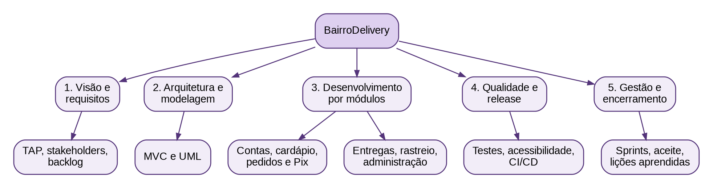

# 1.7 ESTRUTURA ANALÍTICA DO PROJETO (EAP)

A Estrutura Analítica do Projeto (EAP) é uma forma de representar o escopo de um projeto, dividindo-o em partes menores que correspondem aos entregáveis, porém, é importante notar que a divisão expressa na EAP não necessariamente corresponde à ordem na qual as atividades serão realizadas.

