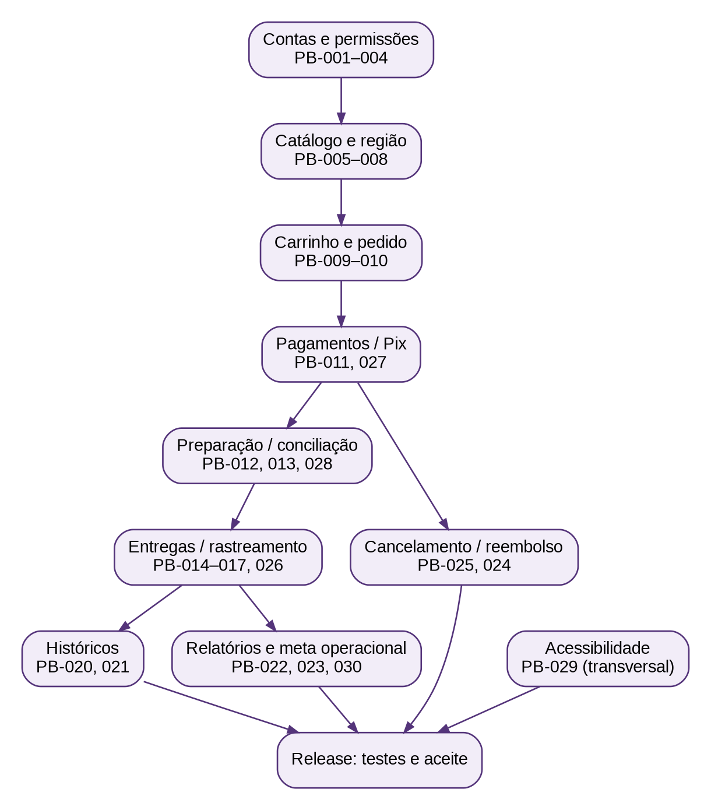

# 4.4 REDE DE PRECEDÊNCIA

A rede expressa acima representa a relação de dependência entre as atividades, não a duração destas. A recuperação de senha e o gerenciamento de perfil (PB-018/019) compõem a base de usuários; além disso, conforme cada incremento for realizado, precisamos verificar se este respeita os requisitos de acessibilidade.
