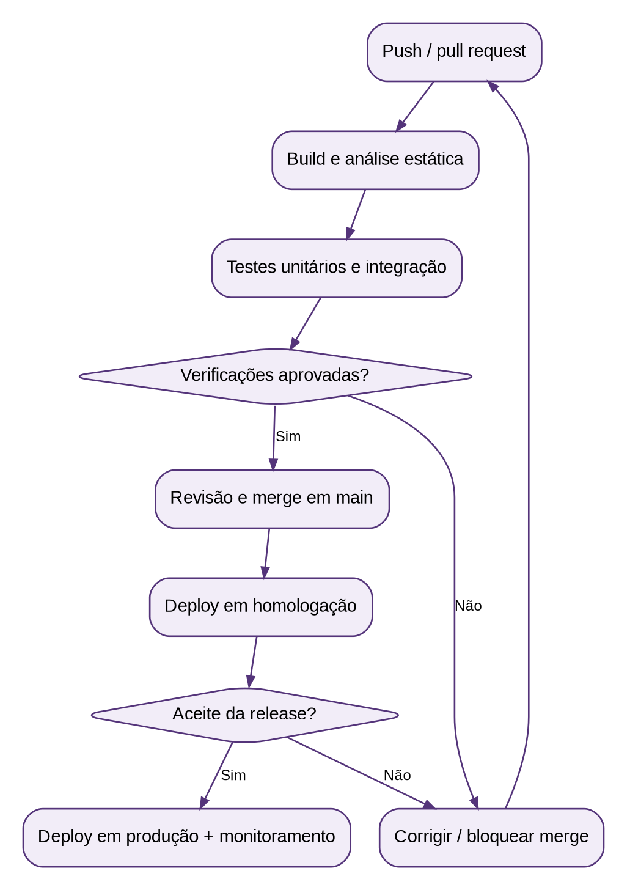

# 5.2 ESTEIRA DE INTEGRAÇÃO E ENTREGA CONTÍNUA (CI/CD)

Para a implementação da esteira de CI/CD, será utilizado o GitHub Actions; é importante notar que a configuração desta depende das tecnologias escolhidas para implementar e realizar o build do sistema. Dito isso, segue o fluxo que se espera da esteira:

A pipeline deve realizar os testes e as análises de segurança de modo que, caso haja uma falha, não seja possível realizar a integração. Posterior à geração do artefato versionado, será necessária uma aprovação para realizar o deploy em produção; além disso, as credenciais devem ser armazenadas de forma segura e, caso haja um problema com a nova versão, deve ser possível retornar à versão anterior.
